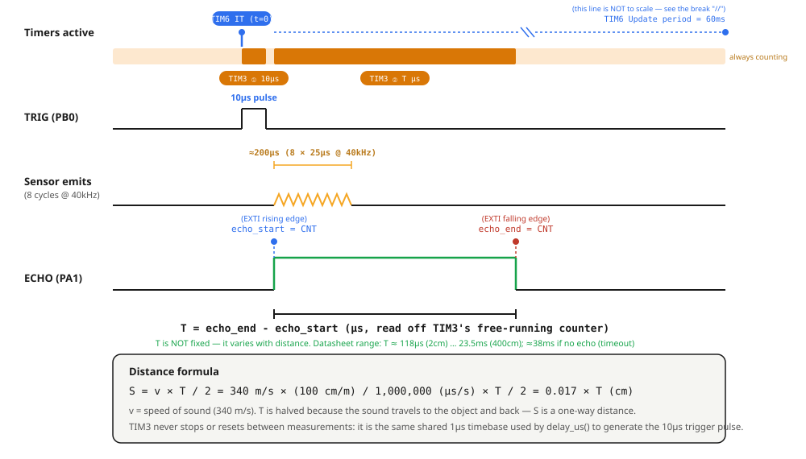
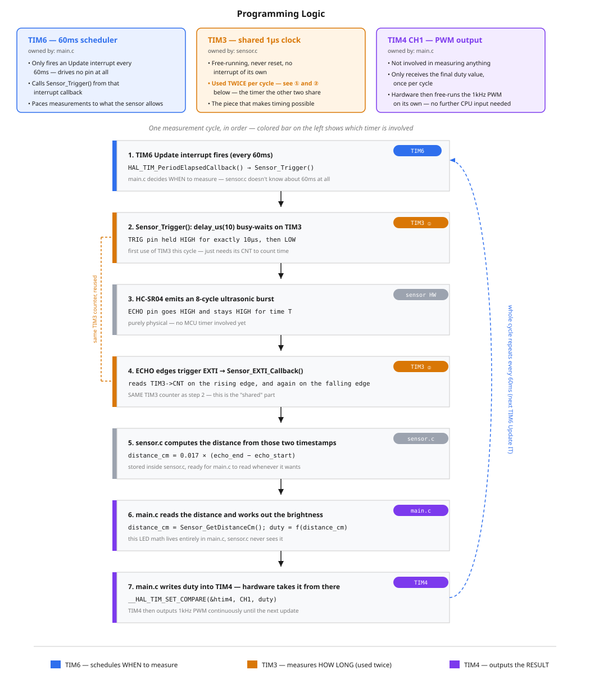
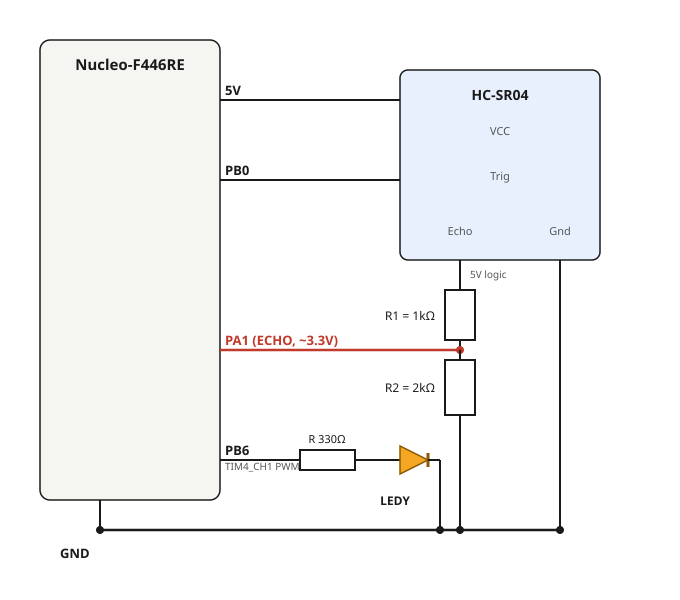

# 5 — Timer + Interrupt: HC-SR04 Ultrasonic Distance → LED Brightness

**Board:** Nucleo-F446RE (STM32F446RETx)
**IDE:** STM32CubeIDE (GCC / make)
**Reference material:** `[STM32 Cơ bản] Buổi 5 Timer.pdf` (timer base/prescaler theory, `delay_us()` via timer, HC-SR04 interfacing)

## What this project is about

An HC-SR04 ultrasonic distance sensor measures how far away an object is, and an LED's brightness tracks that distance in real time: bring your hand closer and the LED gets brighter, pull it away and the LED dims. Nothing here uses `HAL_Delay()` or a busy-polling loop to measure the echo — the whole pipeline is built out of timer + interrupt primitives:

| Timer | Role |
|---|---|
| **TIM3** | Free-running 1µs counter (no interrupt) — shared timebase for `delay_us()` and for timestamping the Echo pulse |
| **TIM6** | Update interrupt every 60ms — schedules each new ranging cycle |
| **EXTI1 (PA1)** | External interrupt, both edges — catches the Echo pin's rising/falling edges to measure the pulse width |
| **TIM4 CH1** | PWM, 1kHz — converts the measured distance into LED brightness |

## How the HC-SR04 sensor works

**Specs:** operating voltage 5V, range 2–400cm, 4 pins — `VCC`, `GND`, `Trig` (trigger input), `Echo` (pulse output); the 5th pin `OUT` is unused.

**Principle of operation:** hold `Trig` HIGH for at least 10µs, and the sensor fires an 8-cycle 40kHz ultrasonic burst out of its transmitter. Right after the burst starts, `Echo` goes HIGH and stays HIGH until the reflected wave comes back into the receiver (or a timeout elapses), then `Echo` drops LOW again. The time `Echo` spends HIGH — call it `T` — is proportional to the round-trip travel time of the sound wave, and therefore to the distance:

```
S = v × T / 2 = 340 m/s × (T in µs) / 1,000,000 / 2 = 0.017 × T   (cm)
```

where `v = 340 m/s` is the speed of sound and the `/2` accounts for the wave travelling to the object **and back**. `T` is not a fixed spec value — it varies with distance; the datasheet only bounds it: `T ≈ 118µs` at 2cm, `T ≈ 23.5ms` at 400cm, and `Echo` returns to LOW on its own after `≈38ms` if nothing is in range (no software timeout needed).

The sensor itself never triggers on its own — it is entirely passive/reactive. Nothing happens until the MCU drives `Trig` HIGH; between measurements the sensor does nothing at all.



## Why 3 timers — how they relate to each other



- **TIM6 decides WHEN to measure.** It drives no pin — its only job is an Update interrupt every 60ms, which calls `Sensor_Trigger()`. HC-SR04 needs ≥60ms between triggers so the previous echo has fully died out before the next one; this is what enforces that pacing.
- **TIM3 measures HOW LONG.** It's a free-running counter, started once and never reset, reused twice per cycle: once by `delay_us()` to time the 10µs `Trig` pulse, and again by the EXTI callback to timestamp both edges of `Echo`. Both uses just *read* the same continuously-running `CNT` register at different moments and take the difference — nothing about TIM3 itself changes between the two uses.
- **TIM4 outputs the RESULT.** It has no idea a sensor exists — it only receives a `duty` value once per cycle and then free-runs the 1kHz PWM in hardware until the next update.

## CubeMX setup & code generation

1. `File → New → STM32 Project` → Board Selector → **NUCLEO-F446RE** → Next → finish the wizard.
2. **Pinout view:**
   - Click **PB0** → set to `GPIO_Output`. Rename it (right-click → Enter User Label) to `TRIG`.
   - Click **PA1** → set to `GPIO_EXTI1`. Rename it to `ECHO`. Under **GPIO** settings, set **GPIO Mode** = `External Interrupt Mode with Rising/Falling edge trigger detection` (both edges — needed to capture the start *and* end of the Echo pulse), **Pull-up/Pull-down** = `No pull`.
   - Click **PB6** → set to `TIM4_CH1`.
3. **Timers → TIM3** tab: tick **Activated** under Clock Source (base timer only — leave every channel `Disable`). Parameter Settings: **Prescaler (PSC)** = `89`, **Counter Mode** = `Up`, **Counter Period (ARR)** = `65535`, **auto-reload preload** = `Disable`.
4. **Timers → TIM4** tab: **Channel1** = `PWM Generation CH1`. Parameter Settings: **Prescaler** = `89`, **Counter Period (ARR)** = `999`, **Pulse** = `0`.
5. **Timers → TIM6** tab: tick **Activated**. Parameter Settings: **Prescaler (PSC)** = `8999`, **Counter Period (ARR)** = `599`.
6. **NVIC settings** (System Core → NVIC): confirm **TIM6 global interrupt** and **EXTI line1 interrupt** are both enabled.
7. **Project Manager → Project**: Toolchain/IDE = `STM32CubeIDE`.
8. **Project Manager → Code Generator**: `Copy only the necessary library files`.
9. **GENERATE CODE**.

## Why these Prescaler / Period values

TIM3, TIM4 and TIM6 all sit on the **APB1** bus, where **APB1 Timer clock = 90MHz**:

```
Counter clock = Timer input clock / (PSC + 1)
Tick period   = 1 / Counter clock
Update period = Tick period × (ARR + 1)
```

- **TIM3:** `PSC = 89` → 90MHz / 90 = **1MHz** → 1µs/tick. `ARR = 65535` (max) so `CNT` free-runs 65.5ms before wrapping — longer than the ~38ms no-echo timeout.
- **TIM6:** `PSC = 8999` → 90MHz / 9000 = 10kHz → 0.1ms/tick. `ARR = 599` → Update period = 0.1ms × 600 = **60ms**.
- **TIM4:** `PSC = 89`, `ARR = 999` → 1MHz / 1000 steps = **1kHz** PWM, 1000 brightness steps.

## Code architecture: `lib/sensor.c` vs `main.c`

The sensor driver lives in its own module, added manually as `lib/sensor.h` + `lib/sensor.c` (not generated by CubeMX). It is scoped to **sensor signal processing only** — reading Trig/Echo and producing a distance in cm. It knows nothing about LEDs or PWM. The LED brightness math lives entirely in `main.c`.

```
lib/
├── sensor.h   - public API
└── sensor.c   - TIM3 ownership, Trig/Echo handling, distance calculation
```

To make CubeIDE see and build `lib/`:
- **Include path:** Project → Properties → C/C++ Build → Settings → Tool Settings → MCU GCC Compiler → Include paths → add `../lib`.
- **Source location:** Project → Properties → C/C++ General → Paths and Symbols → Source Location tab (pick a single configuration, e.g. Debug — this tab doesn't support "All configurations") → Add Folder... → `lib`. Repeat for the Release configuration.

### `sensor.h` — public API

```c
void Sensor_Init(TIM_HandleTypeDef *htim_us,
                  GPIO_TypeDef *trig_port, uint16_t trig_pin,
                  GPIO_TypeDef *echo_port, uint16_t echo_pin);
void Sensor_Trigger(void);                      // call every 60ms (from TIM6's callback)
void Sensor_EXTI_Callback(uint16_t GPIO_Pin);    // forward every EXTI interrupt here
uint32_t Sensor_GetDistanceCm(void);             // read the latest result, anytime
```

### `sensor.c` — how each function works

**`Sensor_Init()`** stores the timer handle and GPIO port/pin arguments into internal `static` variables (function parameters are local and disappear once `Sensor_Init()` returns, so this is what lets every other function in the file remember them later), then starts TIM3 free-running:

```c
void Sensor_Init(TIM_HandleTypeDef *htim_us,
                  GPIO_TypeDef *trig_port, uint16_t trig_pin,
                  GPIO_TypeDef *echo_port, uint16_t echo_pin)
{
  s_htim_us   = htim_us;
  s_trig_port = trig_port;
  s_trig_pin  = trig_pin;
  s_echo_port = echo_port;
  s_echo_pin  = echo_pin;

  HAL_TIM_Base_Start(s_htim_us);
}
```

**`delay_us()`** is a private (`static`) busy-wait built on TIM3's free-running counter — it never resets TIM3, just reads `CNT` and waits for it to advance:

```c
static void delay_us(uint16_t us)
{
  uint16_t start = (uint16_t)__HAL_TIM_GET_COUNTER(s_htim_us);
  while ((uint16_t)((uint16_t)__HAL_TIM_GET_COUNTER(s_htim_us) - start) < us)
  {
  }
}
```

**`Sensor_Trigger()`** fires one 10µs pulse on `Trig`, guarded by `s_measurement_busy` so a new trigger is ignored if the previous echo hasn't finished yet:

```c
void Sensor_Trigger(void)
{
  if (s_measurement_busy) return;
  s_measurement_busy = 1;

  HAL_GPIO_WritePin(s_trig_port, s_trig_pin, GPIO_PIN_SET);
  delay_us(TRIG_PULSE_US);
  HAL_GPIO_WritePin(s_trig_port, s_trig_pin, GPIO_PIN_RESET);
}
```

**`Sensor_EXTI_Callback()`** timestamps both edges of `Echo` using the same TIM3 counter, and computes the distance the moment the falling edge arrives:

```c
void Sensor_EXTI_Callback(uint16_t GPIO_Pin)
{
  if (GPIO_Pin != s_echo_pin) return;

  if (HAL_GPIO_ReadPin(s_echo_port, s_echo_pin) == GPIO_PIN_SET)
  {
    s_echo_start = __HAL_TIM_GET_COUNTER(s_htim_us);
  }
  else
  {
    s_echo_end = __HAL_TIM_GET_COUNTER(s_htim_us);
    uint16_t pulse_width_us = (uint16_t)(s_echo_end - s_echo_start);

    uint32_t distance = (uint32_t)(0.017f * (float)pulse_width_us);
    if (distance < SENSOR_MIN_CM) distance = SENSOR_MIN_CM;
    if (distance > SENSOR_MAX_CM) distance = SENSOR_MAX_CM;
    s_distance_cm = distance;

    s_measurement_busy = 0;
  }
}
```

**`Sensor_GetDistanceCm()`** just returns the last computed value — safe to call from `main.c` at any time.

## `main.c` — wiring the driver up and driving the LED

**Includes and constants:**
```c
#include "sensor.h"

#define LED_ACTIVE_RANGE_CM 50   // beyond this distance the LED reads as fully off
#define PWM_MAX_DUTY         999
```

**Startup, after the `MX_..._Init()` calls:**
```c
Sensor_Init(&htim3, TRIG_GPIO_Port, TRIG_Pin, ECHO_GPIO_Port, ECHO_Pin);
HAL_TIM_PWM_Start(&htim4, TIM_CHANNEL_1);
HAL_TIM_Base_Start_IT(&htim6);
```

**Main loop — read the distance, map it to a duty, write it out:**
```c
while (1)
{
  uint32_t distance_cm = Sensor_GetDistanceCm();
  uint32_t led_cm = (distance_cm > LED_ACTIVE_RANGE_CM) ? LED_ACTIVE_RANGE_CM : distance_cm;
  uint32_t duty = PWM_MAX_DUTY - ((led_cm - 2) * PWM_MAX_DUTY / (LED_ACTIVE_RANGE_CM - 2));
  __HAL_TIM_SET_COMPARE(&htim4, TIM_CHANNEL_1, duty);
}
```

`(distance_cm > LED_ACTIVE_RANGE_CM) ? LED_ACTIVE_RANGE_CM : distance_cm` is the ternary operator — shorthand for an `if/else` that just assigns a value: clamp `distance_cm` to at most 50cm before it feeds the brightness formula, so an object farther than that always reads as "off" (0 duty) instead of the unsigned subtraction underflowing into a huge number.

The mapping is a linear inverse: at 2cm (closest), `duty = 999` (brightest); at 50cm, `duty = 0` (off). Closer → higher duty → brighter LED.

**Callbacks — the only two places TIM6 and EXTI connect back into the driver:**
```c
void HAL_GPIO_EXTI_Callback(uint16_t GPIO_Pin)
{
  Sensor_EXTI_Callback(GPIO_Pin);
}

void HAL_TIM_PeriodElapsedCallback(TIM_HandleTypeDef *htim)
{
  if (htim->Instance == TIM6)
  {
    Sensor_Trigger();
  }
}
```

## Wiring



| Signal | Nucleo pin | Notes |
|---|---|---|
| HC-SR04 `VCC` | 5V | |
| HC-SR04 `GND` | GND | |
| HC-SR04 `Trig` | PB0 (labeled **A3** on the Arduino header) | Direct connection — the sensor reads a 3.3V HIGH from the Nucleo fine |
| HC-SR04 `Echo` | PA1 (labeled **A1**), through a **1kΩ/2kΩ resistor divider** | See below — do **not** connect Echo straight to PA1 |
| LEDY (PWM) | PB6 (labeled **D10**), `TIM4_CH1` | Through a ~330Ω series resistor to GND |

**Double-check board silkscreen labels against the schematic pin, not just the letter/number.** On the Nucleo-F446RE Arduino header, `A0` = PA0 and `A3` = PB0 — easy to grab the wrong one since both sit in the analog header row. `Trig` must land on **A3**, not A0.

**Echo needs a voltage divider.** The HC-SR04 runs its logic at 5V, so `Echo` swings 0–5V — feeding that straight into a 3.3V STM32 GPIO risks exceeding its input tolerance. Build a simple divider: `Echo → R1 (1kΩ) → node → R2 (2kΩ) → GND`, and tap `PA1` off the middle node. That divides the 5V signal down to `5V × 2kΩ/(1kΩ+2kΩ) ≈ 3.3V`, which is safe for PA1.

## Debugging with Live Expressions

1. Start a debug session, open `Window → Show View → Live Expressions`.
2. Add `Sensor_GetDistanceCm()` and `htim4.Instance->CCR1` as expressions (function calls and direct register reads both work in this view).
3. Toggle **Enable Live Watch**, then **Resume** — move your hand toward/away from the sensor and watch both values update, along with the LED itself.

## Folder structure

```
5_Timer_Interrupt/
├── Core/Src/main.c              - MX_TIM3/4/6_Init, LED brightness mapping, EXTI + TIM6 callbacks
├── lib/sensor.h, lib/sensor.c   - sensor-only driver: TIM3 ownership, Trig/Echo, distance calc
├── 5_Timer_Interrupt.ioc        - CubeMX project (TIM3 base, TIM4 CH1 PWM, TIM6 base+IT, PA1 EXTI, PB0 output)
├── wiring_diagram.svg
├── hcsr04_timing_diagram.svg    - Trigger/Echo timing and how TIM3 + EXTI measure the pulse width
└── timers_role_diagram.svg      - why 3 timers are needed and how TIM3 is shared across 2 steps
```
