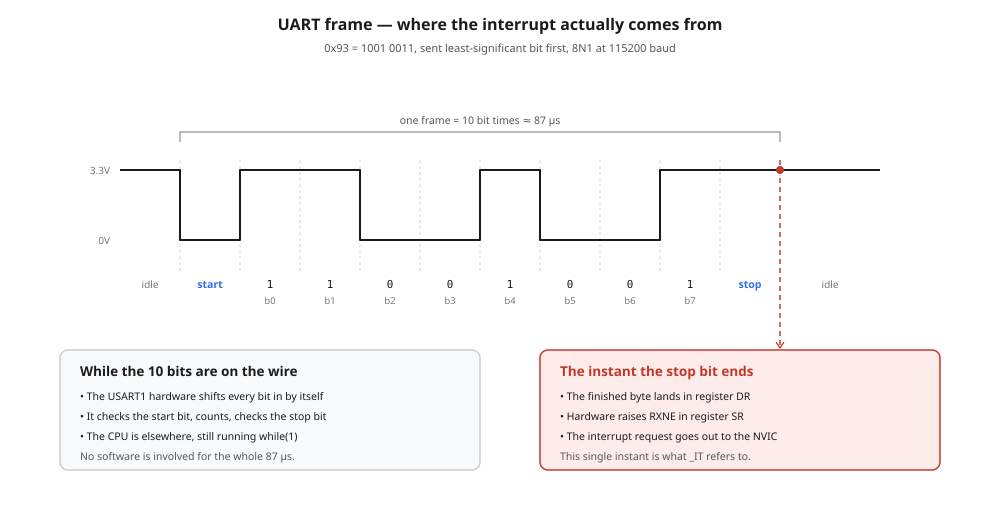
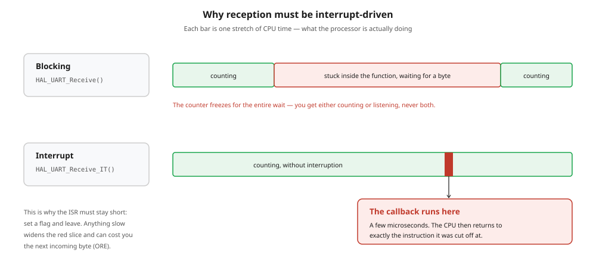
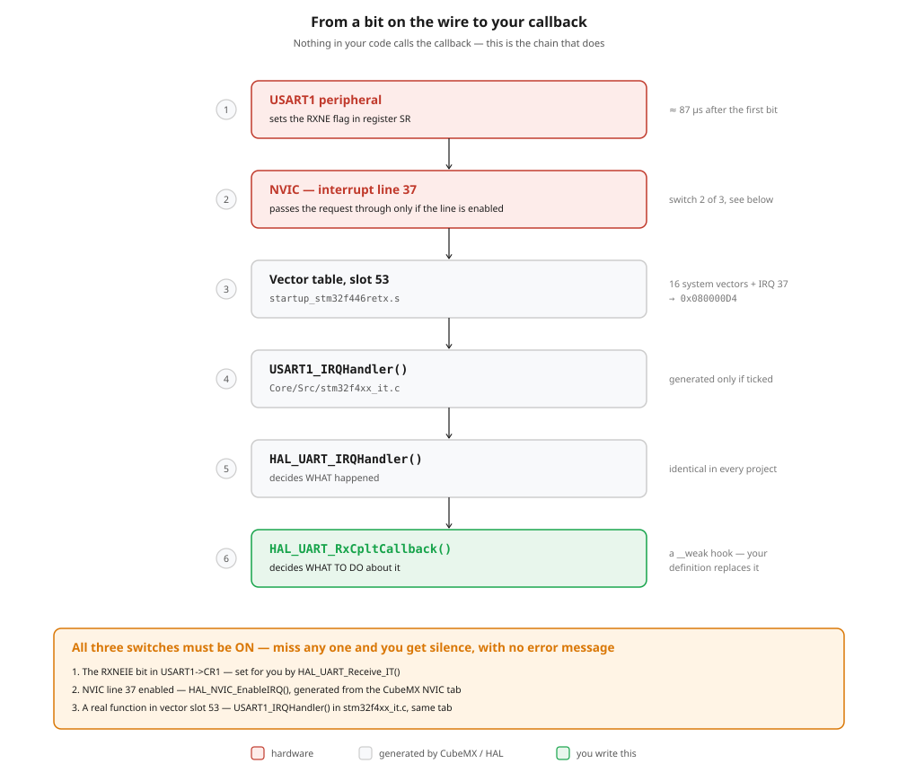
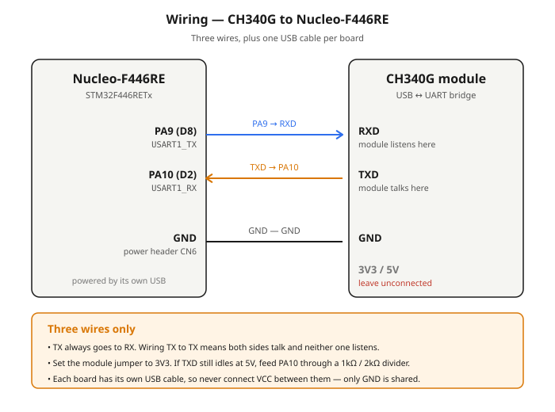

# 6.1 — UART: "Hello World" over a CH340G, stopped and resumed from the keyboard

**Board:** Nucleo-F446RE (STM32F446RETx)
**IDE:** STM32CubeIDE (GCC / make)

## What this project is about

The board introduces itself on the serial port and then counts:

```
Hello World, I am counting to 100....
1....
2....
3....
```

One number per second, wrapping back to 1 after 100. While it counts, it is also **listening**. Type `s` in the terminal and the counting stops; type `r` and it picks up again from where it left off. Nothing else changes — the same `while(1)` keeps running the whole time.

That combination is the entire point of the project. Sending is the easy half. Receiving *without* freezing the thing you were already doing is the half that requires interrupts, and this is the first project in the series where the MCU has to react to the outside world at a moment it cannot predict.

| Concept | Where it shows up |
|---|---|
| **UART framing** | Baud rate, start/stop bits, 8N1 — why both ends must agree |
| **Blocking transmit** | `HAL_UART_Transmit()` — fine for output, fatal for input |
| **Interrupt-driven receive** | `HAL_UART_Receive_IT()` + `HAL_UART_RxCpltCallback()` |
| **`volatile`** | A flag written by an interrupt and read by `main()` |
| **Error recovery** | `HAL_UART_ErrorCallback()` and the overrun (ORE) trap |
| **Non-blocking timing** | `HAL_GetTick()` again, but now with a pause that must not accumulate debt |

## Hardware

### Nucleo-F446RE

The Nucleo already contains a USB-to-serial bridge inside its ST-Link chip, wired to `PA2`/`PA3` (USART2). One USB cable would be enough to print to a terminal.

This project deliberately does **not** use it. It uses `USART1` on `PA9`/`PA10` and an external module instead, so that the wiring is explicit: you have to run TX and RX yourself, decide which pin listens and which talks, and share a ground. That is exactly the situation you are in with a GPS module, an ESP8266, or the HC-06 Bluetooth module — none of which come with a friendly bridge already soldered to the board.

### CH340G USB-to-UART module

A laptop speaks USB; an STM32 speaks UART. They cannot be connected directly, so a bridge chip converts between the two and presents itself to the operating system as a virtual COM port.

| | |
|---|---|
| **Chip** | WCH CH340G |
| **Logic level** | Selectable 3.3V or 5V via an onboard jumper — **set it to 3V3** |
| **Driver** | Usually automatic on Windows 11; otherwise install `CH341SER` from WCH |
| **Appears as** | `USB-SERIAL CH340 (COMx)` under *Ports (COM & LPT)* in Device Manager |
| **Pins used here** | `TXD`, `RXD`, `GND` |

Equivalent modules — PL2303, CP2102, FT232 — work identically; only the driver differs.

> **Check the logic level with a multimeter before wiring.** On some cheap modules the jumper only changes the voltage on the `VCC` *output* pin while the chip itself still runs at 5V. With the module plugged into USB and nothing else connected, measure `TXD` against `GND`. An idle UART line sits HIGH, so that reading *is* the logic level. If it reads ~5V rather than ~3.3V, feed `PA10` through a 1kΩ / 2kΩ divider instead of connecting it directly.

## How UART works

UART is **asynchronous**: there is no clock wire. Each side runs its own timer and both must be told the same baud rate in advance — here `115200`, 8 data bits, no parity, 1 stop bit (`8N1`). If the two disagree by more than roughly 2–3%, the receiver samples at the wrong instants and you get garbage characters rather than an error.

With no clock to mark where a byte begins, the line itself carries the framing. It idles HIGH; a **start bit** pulls it LOW to announce that data is coming; eight **data bits** follow, least-significant bit first; a **stop bit** returns the line HIGH.



The important part of that picture is what the CPU is doing during the frame: **nothing**. The USART1 peripheral shifts every bit in by itself. Only when the stop bit ends — about 87µs after the first bit at 115200 baud — does the finished byte land in the data register `DR` and the hardware raise the `RXNE` flag. That single instant is the event everything else in this project hangs off.

## Why reception must be interrupt-driven

HAL offers both styles. The difference is not convenience, it is whether the program can do two things at once.



`HAL_UART_Receive()` blocks: the CPU sits inside the function reading the `RXNE` flag over and over until a byte arrives or the timeout expires. Since a user might not press a key for minutes, the counter would freeze for minutes. You would get either counting or listening, never both.

`HAL_UART_Receive_IT()` arms the peripheral and returns immediately. The counting loop runs uninterrupted, and only when a byte actually arrives does the CPU get pulled aside for a few microseconds.

Transmission keeps the blocking call, and that is fine: `HAL_UART_Transmit()` of a short string at 115200 baud takes about a millisecond, and it happens at a moment the program chose.

## What happens between the wire and your callback

`HAL_UART_RxCpltCallback()` is never called anywhere in this project's code, yet it runs. This is the chain that makes that happen.



Two details are worth internalising, because both are silent when wrong:

**The callback is a weak symbol.** `stm32f4xx_hal_uart.c` defines an empty `__weak void HAL_UART_RxCpltCallback(...)`. Defining a function with the same name in `main.c` makes the linker discard the empty one and use yours. Misspell the name by one character and there is **no compiler error** — the build succeeds, the board runs, and nothing responds, because HAL is still calling the empty version.

**Three switches must all be on.** Miss any one and there is total silence, with no error:

1. The `RXNEIE` bit in `USART1->CR1` — set for you by `HAL_UART_Receive_IT()`
2. NVIC line 37 enabled — `HAL_NVIC_EnableIRQ()`, generated only when the CubeMX **NVIC** box is ticked
3. A real function in vector slot 53 — `USART1_IRQHandler()` in `stm32f4xx_it.c`, generated from the same tick

## Wiring



| CH340G | Nucleo-F446RE | Location on the board |
|---|---|---|
| `TXD` | **PA10** (`USART1_RX`) | header `CN9`, pin labelled `D2` |
| `RXD` | **PA9** (`USART1_TX`) | header `CN5`, pin labelled `D8` |
| `GND` | `GND` | power header `CN6`, either GND pin next to `5V` |
| `3V3` / `5V` | **not connected** | — |

Three wires, and two separate USB cables — one per board.

**TX goes to RX.** The names describe what each pin does, not what it connects to. `TXD`–`TXD` means both sides are talking and neither is listening; you get silence, and nothing indicates why.

**GND is mandatory, and not for power.** A logic HIGH of 3.3V is 3.3V *relative to something*. Two boards powered from two different USB ports have no shared reference, so "3.3V" is meaningless between them and reception is either dead or garbage. The ground wire supplies the reference, which is why it is needed even though both boards already have power.

**`VCC` stays disconnected.** The module's `3V3` and `5V` pins are outputs, and so is the Nucleo's `3V3` pin. Tying two regulators together achieves nothing here and lets the higher one push current back into the lower one. A sensor with no USB port of its own is a different situation — that one does need `VCC`.

## CubeMX setup & code generation

1. `File → New → STM32 Project` → Board Selector → **NUCLEO-F446RE** → Next → finish the wizard.
2. **Connectivity → USART1** → **Mode** = `Asynchronous`.
3. USART1 **Parameter Settings**: Baud Rate `115200`, Word Length `8 Bits (including Parity)`, Parity `None`, Stop Bits `1`, Data Direction `Receive and Transmit`, Over Sampling `16 Samples`.
4. **Pinout view**: confirm `PA9` = `USART1_TX` and `PA10` = `USART1_RX`. If CubeMX assigned the alternate pair (`PB6`/`PB7`), right-click and move them back — the wiring above assumes PA9/PA10.
5. **System Core → NVIC**: tick **USART1 global interrupt**. Without this the callback is never reached.
6. **Project Manager → Project**: Toolchain/IDE = `STM32CubeIDE`.
7. **Project Manager → Code Generator**: `Copy only the necessary library files`.
8. **GENERATE CODE**.

Verify step 5 landed: `stm32f4xx_hal_msp.c` should now contain `HAL_NVIC_EnableIRQ(USART1_IRQn)`, and `stm32f4xx_it.c` should contain `USART1_IRQHandler()`. If either is missing, the tick did not take.

### A note on the clock source

Generating from the Board Selector configures `HSE` — the accurate 8MHz clock the ST-Link chip supplies. If the project was created from the MCU selector instead, it defaults to `HSI`, the internal RC oscillator, which drifts ±1% at room temperature and up to ±4% across the datasheet's temperature range. UART tolerates roughly ±2.5% total, so HSI usually works on a warm desk and is a bad habit everywhere else.

To switch: **System Core → RCC** → **High Speed Clock (HSE)** = `BYPASS Clock Source` (bypass, not crystal — the Nucleo has no crystal, just a square wave from the ST-Link), then in **Clock Configuration** set input `8` MHz, PLL source `HSE`, `PLLM = 4`, `PLLN = 180`, `PLLP = /2`, giving 180MHz.

## The code

All of it lives in `main.c`, inside the `USER CODE` markers.

### Globals

```c
/* USER CODE BEGIN PV */
uint8_t          rx_byte;
volatile uint8_t running = 1;
/* USER CODE END PV */
```

`rx_byte` is the one-byte landing slot HAL writes into. `running` is the flag the interrupt sets and the main loop reads.

`volatile` is not decoration. The main loop never assigns `running`, so the compiler is entitled to conclude it cannot change, load it into a register once and never read RAM again. The interrupt would then update memory that nobody looks at. This compiles and runs correctly at `-O0` (Debug) and breaks at `-O2` (Release) — which is the worst possible time to discover it. `volatile` forces a re-read on every access.

### Callbacks

```c
/* USER CODE BEGIN 0 */
void HAL_UART_RxCpltCallback(UART_HandleTypeDef *huart)
{
  if (huart->Instance == USART1)
  {
    if (rx_byte == 's')
    {
      running = 0;
    }
    else if (rx_byte == 'r')
    {
      running = 1;
    }

    HAL_UART_Receive_IT(&huart1, &rx_byte, 1);
  }
}

void HAL_UART_ErrorCallback(UART_HandleTypeDef *huart)
{
  if (huart->Instance == USART1)
  {
    __HAL_UART_CLEAR_OREFLAG(&huart1);
    HAL_UART_Receive_IT(&huart1, &rx_byte, 1);
  }
}
/* USER CODE END 0 */
```

**A single character is a whole command**, so there is no buffer, no string comparison, and no need to decide when a command has ended. This is the reason the receive side is six lines rather than sixty.

**`huart->Instance == USART1`** — the callback is shared by every UART on the chip. Today there is only one, but the check is what keeps it correct when USART2 is added.

**`HAL_UART_Receive_IT()` must be called again inside the callback.** It is a one-shot: it arms the peripheral, waits for the requested number of bytes, fires the callback, and disarms itself. Without re-arming you receive exactly one character for the lifetime of the program. It is placed last, after `rx_byte` has been read, so the hardware cannot overwrite the value mid-use.

**`HAL_UART_ErrorCallback()` is what keeps reception alive.** USART1 has a single receive register and no queue. If a byte arrives before the previous one has been read, the old one is lost and the hardware raises the **overrun** flag `ORE`. HAL treats overrun as a blocking error: it calls `UART_EndRxTransfer()`, which *cancels the armed reception*, and then calls this callback. Leave the callback undefined and HAL uses its empty `__weak` version — nothing re-arms, and the UART goes deaf permanently while transmission carries on looking healthy. One clear macro is enough: in the F4 HAL, `__HAL_UART_CLEAR_FEFLAG`, `NEFLAG` and `OREFLAG` are all `#define`d to `__HAL_UART_CLEAR_PEFLAG`.

### Setup in `main()`

```c
  /* USER CODE BEGIN 2 */
  char     buf[64];
  int      n;
  uint32_t count     = 1;
  uint32_t last_tick = HAL_GetTick();

  HAL_UART_Receive_IT(&huart1, &rx_byte, 1);
  /* USER CODE END 2 */
```

`buf` is the scratch pad. `count` holds a binary number — `42` is one byte, `0x2A` — while the terminal needs the two ASCII characters `'4'` `'2'`. `snprintf` performs that conversion, and it has to write the result somewhere; `buf` is that somewhere.

The `HAL_UART_Receive_IT()` call here is the initial arming. Every later one happens inside the callback.

### Main loop

```c
    /* USER CODE BEGIN 3 */
    if (!running)
    {
      last_tick = HAL_GetTick();
    }
    else if (HAL_GetTick() - last_tick >= COUNT_INTERVAL_MS)
    {
      last_tick += COUNT_INTERVAL_MS;

      if (count == 1)
      {
        n = snprintf(buf, sizeof(buf),
                     "\r\nHello World, I am counting to %u....\r\n", COUNT_MAX);
        HAL_UART_Transmit(&huart1, (uint8_t *)buf, n, HAL_MAX_DELAY);
      }

      n = snprintf(buf, sizeof(buf), "%u....\r\n", count);
      HAL_UART_Transmit(&huart1, (uint8_t *)buf, n, HAL_MAX_DELAY);

      count = (count >= COUNT_MAX) ? 1 : count + 1;
    }
```

**`HAL_GetTick() - last_tick >= INTERVAL`, never `HAL_GetTick() >= last_tick + INTERVAL`.** `HAL_GetTick()` is a `uint32_t` that wraps to zero after about 49.7 days. Because the subtraction is unsigned, the difference stays correct across the wrap; the addition form does not.

**`last_tick += COUNT_INTERVAL_MS` rather than `= HAL_GetTick()`.** Adding a constant pins each deadline to an absolute grid. Assigning "now" would restart the interval from the moment the code happened to get here, which is already a millisecond late because `HAL_UART_Transmit` blocks — and that error compounds every cycle.

**`if (!running) { last_tick = HAL_GetTick(); }` is a consequence of that choice.** While paused, `last_tick` would otherwise stand still while the clock ran on. Pause for 30 seconds and the difference reaches 30000; on resume the condition would be satisfied 30 times in a row, each `+= 1000` clawing back only one second, and thirty numbers would spill out at once. Dragging `last_tick` along with the present tense means there is no debt to repay. Nothing blocks in this branch — the loop still spins millions of times a second, which is precisely why `r` takes effect instantly.

**`count + 1`, never `count++`.** `count++` evaluates to the *old* value and then increments; the surrounding assignment writes that old value straight back, so the variable never moves and the board prints `1....` forever. It is also undefined behaviour, since `count` would be modified twice in one expression.

**`snprintf`, not `sprintf`.** `sprintf` has no idea how large the buffer is. `snprintf` is bounded by `sizeof(buf)`, so the worst case is a truncated string rather than a stack smash. Its return value is the byte count `HAL_UART_Transmit` needs, so there is no reason to call `strlen` afterwards.

**`\r\n`, not `\n`.** Hercules needs the carriage return to move the cursor back to column one. With `\n` alone the output marches diagonally down the screen.

## Running it

1. Plug in both USB cables. Check Device Manager for `USB-SERIAL CH340 (COMx)` and note the number.
2. Open Hercules, **Serial** tab: `Name` = your COM port, `Baud` = `115200`, `Data size` = `8`, `Parity` = `none`, `Handshake` = `OFF`, `Mode` = `Free`. Click **Open**.
3. Flash the board and press the black **RESET** button.
4. The greeting appears, then a number every second.
5. Type `s` in the first **Send** field and click **Send** — counting stops. Type `r` and click **Send** — it resumes.

The `HEX` checkbox beside the Send field stays unticked. No line terminator is needed: Hercules sends exactly the characters you type, and since one character is a complete command here, that is all this project wants.

## Common failure modes

| Symptom | Cause |
|---|---|
| Nothing at all | TX/RX not crossed; GND not shared; wrong COM port; port still held open by another program |
| Garbage characters | Baud rate mismatch between Hercules and CubeMX; or HSI drift — check the clock source |
| Text marches diagonally right | `\n` without `\r` |
| Prints `1....` forever | `count++` instead of `count + 1` |
| Counting works, `s` does nothing | NVIC not ticked in CubeMX; or the callback name is misspelled; or `volatile` missing from `running` |
| Worked, then stopped responding to keys | Overrun (`ORE`) with no `HAL_UART_ErrorCallback()` to re-arm reception |
| Burst of numbers after pressing `r` | The `if (!running)` branch is missing its `last_tick = HAL_GetTick()` |

**Isolating the fault:** unplug both wires from the Nucleo and short the module's own `TXD` to its `RXD`. Type into Hercules and send; the characters must appear in the receive window. If they do, the module, driver, COM port and baud rate are all correct and the problem is on the STM32 side. If they do not, stop debugging firmware.

## Folder structure

```
6_1_UART_HELLO_WORLD/
├── Core/Src, Core/Inc                 - CubeMX-generated HAL init code + application code
├── Drivers/                           - STM32 HAL + CMSIS (generated, not hand-edited)
├── 6_UART_HELLO_WORLD.ioc             - CubeMX pin/clock configuration
├── README.md                          - this file
├── wiring_diagram.svg                 - how to wire the CH340G to the Nucleo
├── uart_frame_diagram.svg             - one UART frame, and where the interrupt comes from
├── polling_vs_interrupt_diagram.svg   - why reception cannot be blocking
└── interrupt_chain_diagram.svg        - RXNE flag → NVIC → vector table → callback
```

## Where this goes next

The receive path is deliberately generic: the MCU cannot tell whether a byte arrived from a CH340G or from somewhere else. Swap the module for an **HC-06 Bluetooth** module on the same three pins and the same callback drives commands sent from a phone. The only firmware change is the baud rate — HC-06 defaults to `9600`, not `115200`.
