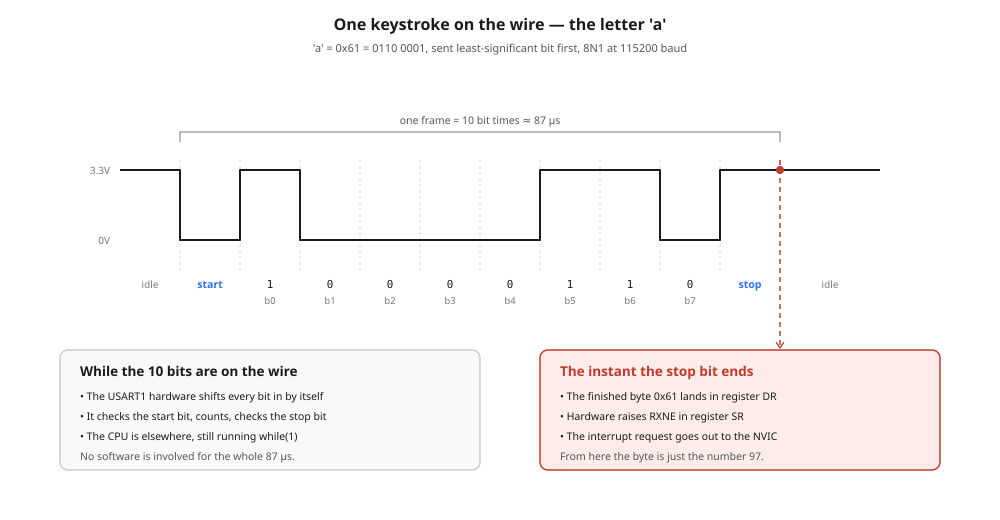
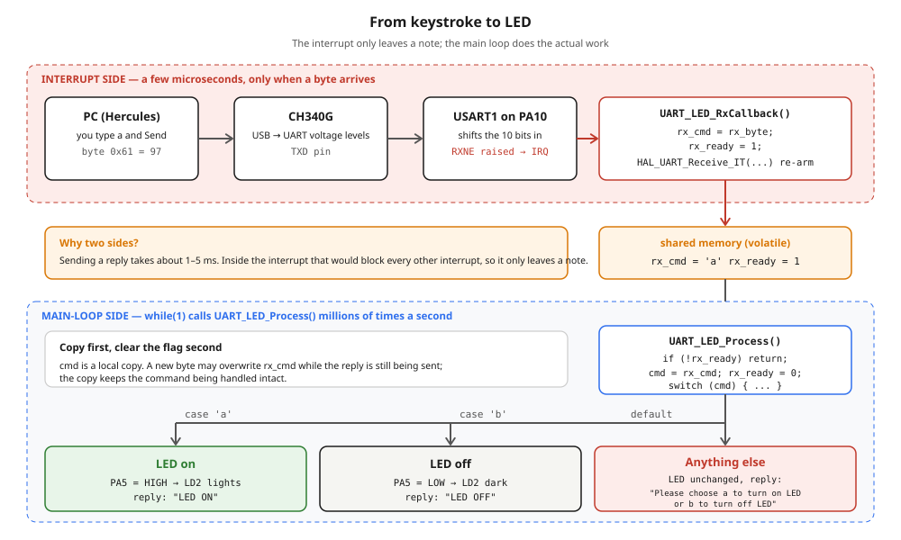
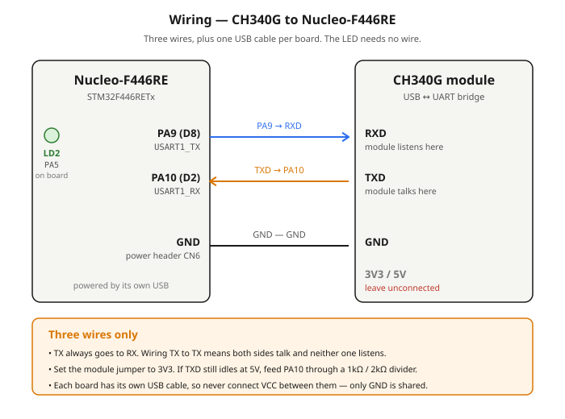

# 6.2 — UART: switching the on-board LED from the keyboard, with a small library

**Board:** Nucleo-F446RE (STM32F446RETx)
**IDE:** STM32CubeIDE (GCC / make)

## What this project is about

Type a letter in the terminal and the LED obeys:

```
UART LED ready. Send 'a' = ON, 'b' = OFF
a   →  LED ON                       (LD2 lights up)
b   →  LED OFF                      (LD2 goes dark)
x   →  Please choose a to turn on LED or b to turn off LED
```

`a` turns the LED on, `b` turns it off, and **anything else** gets a warning instead of being silently ignored. Every command is answered, so the terminal always shows that the board heard you.

Project 6.1 already did "listen without freezing", with all the code sitting in `main.c`. This project keeps that receive mechanism and changes the *shape* of the program: everything about the UART and the LED lives in a two-file **library** (`uart_led.h` / `uart_led.c`), and `main.c` shrinks to four one-line calls. That is the habit worth building here — the same library could drive a different LED, or be copied into the next project, without touching anything else.

| Concept | Where it shows up |
|---|---|
| **Characters are numbers** | `'a'` is the byte `0x61`; `case 'a':` is just a comparison with 97 |
| **Command dispatch** | One received byte → one `switch` → one action |
| **Input validation** | The `default:` branch answers unknown input instead of ignoring it |
| **Interrupt-driven receive** | `HAL_UART_Receive_IT()` + `HAL_UART_RxCpltCallback()`, as in 6.1 |
| **Interrupt → main-loop hand-off** | A `volatile` flag and a one-byte mailbox; the interrupt leaves a note, the loop does the work |
| **Library structure** | Header = public contract; `static` = private to the `.c` file |
| **Passing a handle** | `UART_LED_Init(&huart1)` instead of hard-coding `huart1` inside the library |

## Hardware

### Nucleo-F446RE

The LED is **LD2**, the green one already on the board, wired to `PA5`. It lights when `PA5` is driven **HIGH**, so `GPIO_PIN_SET` means on and `GPIO_PIN_RESET` means off. No resistor and no wire needed.

As in 6.1, the UART is deliberately **not** the ST-Link's built-in virtual COM port (`USART2`, `PA2`/`PA3`). It is `USART1` on `PA9`/`PA10` with an external CH340G module, so the TX/RX wiring is something you have to get right yourself.

### CH340G USB-to-UART module

A laptop speaks USB; an STM32 speaks UART. The CH340G converts between them and shows up in Windows as a virtual COM port.

| | |
|---|---|
| **Chip** | WCH CH340G |
| **Logic level** | Selectable 3.3V or 5V via an onboard jumper — **set it to 3V3** |
| **Driver** | Usually automatic on Windows 11; otherwise install `CH341SER` from WCH |
| **Appears as** | `USB-SERIAL CH340 (COMx)` under *Ports (COM & LPT)* in Device Manager |
| **Pins used here** | `TXD`, `RXD`, `GND` |

> **Check the logic level with a multimeter before wiring.** With the module plugged into USB and nothing else connected, measure `TXD` against `GND`. An idle UART line sits HIGH, so that reading *is* the logic level. If it reads ~5V instead of ~3.3V, feed `PA10` through a 1kΩ / 2kΩ divider rather than connecting it directly.

## How UART works

UART is **asynchronous**: there is no clock wire. Each side runs its own timer and both must be told the same speed in advance — here `115200` baud, 8 data bits, no parity, 1 stop bit (`8N1`). If the two sides disagree by more than roughly 2–3%, the receiver samples at the wrong instants and you get garbage characters rather than an error. (Wrong baud rate is also the most common reason for "nothing happens": a terminal left at `9600` will not understand a board talking at `115200`.)

### A keystroke is a number

The PC does not send the *letter* `a`. It sends the number **97**, and the terminal on the other end agrees to draw 97 as `a`. That agreement is the ASCII table:

| Key | Decimal | Hex | Binary |
|---|---|---|---|
| `a` | 97 | `0x61` | `0110 0001` |
| `b` | 98 | `0x62` | `0110 0010` |
| Enter | 13 + 10 | `0x0D 0x0A` | `\r` `\n` |

In C, `'a'` is simply another way to write `97`. So `case 'a':` in the firmware is a comparison between the received byte and the number 97, and `default:` catches every other number from 0 to 255.

### One byte on the wire

With no clock wire, the line itself carries the framing. It idles HIGH; a **start bit** pulls it LOW to announce a byte; eight **data bits** follow, **least-significant bit first**; a **stop bit** returns the line HIGH.



Note the order of the bits: `0x61` is `0110 0001`, but it travels as `1 0 0 0 0 1 1 0` because the lowest bit goes first.

At 115200 baud one bit lasts 1 / 115200 ≈ 8.7µs, so a whole frame (1 start + 8 data + 1 stop = 10 bits) takes about **87µs**. For that whole time the CPU is **not involved**: the USART1 peripheral shifts the bits in by itself. Only when the stop bit ends does the finished byte land in the data register `DR` and the hardware raise the `RXNE` flag. That single instant is what everything in this project hangs off.

### From the flag to your function

`HAL_UART_RxCpltCallback()` is never called by any line of this project's own code, yet it runs. The chain that makes that happen (RXNE → `USART1_IRQHandler` → HAL → callback) is the same one drawn in [6.1's interrupt chain diagram](../6_1_UART_HELLO_WORLD/interrupt_chain_diagram.svg). The two details worth keeping in mind, because both fail *silently*:

- **Three switches must all be on:** `RXNEIE` in `USART1->CR1` (set by `HAL_UART_Receive_IT()`), the NVIC line for USART1 (generated only when the CubeMX **NVIC** box is ticked), and `USART1_IRQHandler()` in `stm32f4xx_it.c` (generated from the same tick). Miss one and the build is clean, the board runs, and nothing responds.
- **The callback is a weak symbol.** HAL ships an empty `__weak` version of `HAL_UART_RxCpltCallback`. Your definition replaces it at link time — but a one-letter typo in the name produces no error, and HAL keeps calling the empty one.

## From keystroke to LED

The program splits the work across two places, on purpose.



**The interrupt side** runs for a few microseconds, only when a byte arrives. It does exactly three things: copy the byte into a mailbox (`rx_cmd`), raise a flag (`rx_ready = 1`), and re-arm the receiver.

**The main-loop side** polls that flag on every pass of `while(1)`. Almost always it is `0` and the function returns immediately. When it is `1`, the loop takes the command, clears the flag, and does the slow part: drive the pin, send the reply.

**Why not just switch the LED inside the interrupt?** Because the reply (`HAL_UART_Transmit`) blocks until every character has left: about 1ms for `LED ON`, about 4.6ms for the warning. While the CPU is stuck inside an interrupt, other interrupts of the same or lower priority — SysTick, which feeds `HAL_GetTick()`, among them — wait. The rule is that an interrupt should be as short as a doorbell press: record that it happened and get out.

## Why a library, and what goes where

| File | Contains | Visible to `main.c`? |
|---|---|---|
| `uart_led.h` | The four function prototypes | Yes — this is the public contract |
| `uart_led.c` | `led_uart`, `rx_byte`, `rx_cmd`, `rx_ready`, `UART_LED_Send()`, and the bodies of the four functions | Only the four public ones |
| `main.c` | `#include "uart_led.h"`, two HAL callbacks that forward to the library, three one-line calls | — |

`static` in front of a variable or function means "private to this `.c` file". `main.c` cannot see `rx_ready` even if it wanted to, so nothing can set the flag by accident. It also means the library can be rewritten freely: as long as the four prototypes stay the same, `main.c` never has to change.

**The library receives the UART as an argument** (`UART_LED_Init(&huart1)`) and stores the pointer in `led_uart`. It never mentions `huart1` by name. Move the project to `USART2` and the only edit is the argument in `main.c`.

## Wiring



| CH340G | Nucleo-F446RE | Location on the board |
|---|---|---|
| `TXD` | **PA10** (`USART1_RX`) | header `CN9`, pin labelled `D2` |
| `RXD` | **PA9** (`USART1_TX`) | header `CN5`, pin labelled `D8` |
| `GND` | `GND` | power header `CN6`, either GND pin next to `5V` |
| `3V3` / `5V` | **not connected** | — |

Three wires, and two separate USB cables — one per board. The LED (`LD2`) is already on the Nucleo.

**TX goes to RX.** The names describe what each pin *does*, not what it connects to. `TXD`–`TXD` means both sides are talking and neither is listening, and nothing tells you why you get silence.

**GND is mandatory, and not for power.** A logic HIGH of 3.3V is 3.3V *relative to something*. Two boards on two USB ports have no shared reference, so "3.3V" means nothing between them. The ground wire supplies the reference.

**`VCC` stays disconnected.** The module's `3V3`/`5V` pins and the Nucleo's `3V3` pin are all outputs; tying two regulators together achieves nothing and lets the higher one push current into the lower one.

## CubeMX setup & code generation

1. `File → New → STM32 Project` → **Board Selector** → **NUCLEO-F446RE** → Next. Project name `6_2_UART_Control_LED`, language `C`.
2. Answer **Yes** to *"Initialize all peripherals with their default Mode?"*. This pre-configures `PA5` as `GPIO_Output` with the user label **`LD2`**, and selects the accurate 8MHz `HSE` clock from the ST-Link — both of which this project relies on.
3. **Pinout view**: click `PA5` and confirm it is `GPIO_Output` labelled `LD2`. If the label is missing, right-click → *Enter User Label* → `LD2`. The label is what generates `LD2_Pin` and `LD2_GPIO_Port` in `main.h`, which the library uses.
4. **Connectivity → USART1** → **Mode** = `Asynchronous`.
5. USART1 **Parameter Settings**: Baud Rate `115200`, Word Length `8 Bits (including Parity)`, Parity `None`, Stop Bits `1`, Data Direction `Receive and Transmit`, Over Sampling `16 Samples`.
6. **Pinout view**: confirm `PA9` = `USART1_TX` and `PA10` = `USART1_RX`. If CubeMX picked the alternate pair (`PB6`/`PB7`), move them back — the wiring above assumes PA9/PA10.
7. **USART1 → NVIC Settings** (or **System Core → NVIC**): tick **USART1 global interrupt**. Without this, no callback is ever reached.
8. **Project Manager → Code Generator**: `Copy only the necessary library files`.
9. **GENERATE CODE** (`Ctrl+S`).

Verify step 7 landed: `stm32f4xx_hal_msp.c` should contain `HAL_NVIC_EnableIRQ(USART1_IRQn)`, and `stm32f4xx_it.c` should contain `USART1_IRQHandler()`.

Then create the two library files in the project tree: `Core/Inc/uart_led.h` and `Core/Src/uart_led.c`. CubeIDE already has `Core/Inc` on the include path and compiles everything under `Core/Src`, so no build settings need changing.

> **Where to write code in `main.c`:** only between the `/* USER CODE BEGIN … */` and `/* USER CODE END … */` markers. Anything outside them is erased the next time CubeMX regenerates. Files you create yourself (`uart_led.c/.h`) are never touched.

## The code

### `Core/Inc/uart_led.h`

```c
#ifndef UART_LED_H
#define UART_LED_H

#include "main.h"

void UART_LED_Init(UART_HandleTypeDef *huart);
void UART_LED_Process(void);
void UART_LED_RxCallback(UART_HandleTypeDef *huart);
void UART_LED_ErrorCallback(UART_HandleTypeDef *huart);

#endif
```

`#ifndef … #endif` is an **include guard**: if the header is pulled in twice (directly and through another header), the second copy is skipped instead of causing "redefinition" errors. `#include "main.h"` brings in HAL, `UART_HandleTypeDef`, and the generated `LD2_Pin` / `LD2_GPIO_Port`.

### `Core/Src/uart_led.c` — private state

```c
#include "uart_led.h"
#include <string.h>

static UART_HandleTypeDef *led_uart;
static uint8_t rx_byte;
static volatile uint8_t rx_cmd;
static volatile uint8_t rx_ready = 0;
```

| Variable | Role |
|---|---|
| `led_uart` | Pointer to the UART handle, saved by `Init` so every other function can use it |
| `rx_byte` | The one-byte landing slot HAL writes the received byte into |
| `rx_cmd` | The mailbox: a copy of the byte, kept for the main loop |
| `rx_ready` | The flag: `1` means "a new command is waiting" |

`rx_cmd` and `rx_ready` are written by the interrupt and read by `while(1)`. The compiler does not know interrupts exist, and nothing in the main loop assigns them, so it is entitled to read them once and cache the value in a register. `volatile` forbids that and forces a fresh read every time. This is the kind of bug that works at `-O0` (Debug) and breaks at `-O2` (Release).

`rx_byte` does not need `volatile`: only HAL writes it and only the callback reads it, both inside the interrupt.

### The send helper

```c
static void UART_LED_Send(const char *msg)
{
  HAL_UART_Transmit(led_uart, (uint8_t *)msg, strlen(msg), HAL_MAX_DELAY);
}
```

Written first because the functions below call it, and C reads top to bottom: a function must be defined above the place that calls it. `strlen` counts the characters so no one counts by hand, and `static` keeps it out of the header.

### `UART_LED_Init`

```c
void UART_LED_Init(UART_HandleTypeDef *huart)
{
  led_uart = huart;

  HAL_GPIO_WritePin(LD2_GPIO_Port, LD2_Pin, GPIO_PIN_RESET);
  UART_LED_Send("\r\nUART LED ready. Send 'a' = ON, 'b' = OFF\r\n");

  HAL_UART_Receive_IT(led_uart, &rx_byte, 1);
}
```

In order: remember which UART we were given (the parameter `huart` dies when `Init` returns; `led_uart` is a `static` variable and lives on); put the LED in a known state; announce that the board is alive (seeing this line in the terminal proves the TX wire, baud rate and COM port are all correct); and arm the receiver.

`HAL_UART_Receive_IT(led_uart, &rx_byte, 1)` reads as: *"receive 1 byte from this UART, store it at this address, and interrupt me when done."* It does not receive anything itself — it enables the interrupt and returns at once.

### `UART_LED_RxCallback` — the interrupt side

```c
void UART_LED_RxCallback(UART_HandleTypeDef *huart)
{
  if (huart != led_uart)
  {
    return;
  }

  rx_cmd   = rx_byte;
  rx_ready = 1;

  HAL_UART_Receive_IT(led_uart, &rx_byte, 1);
}
```

**`huart != led_uart`** — HAL calls this callback for *every* UART on the chip. The check keeps the library from reacting to another UART's bytes.

**`rx_cmd = rx_byte;`** — `rx_byte` is about to be overwritten by the next incoming byte, so the command is copied out to the mailbox.

**`HAL_UART_Receive_IT()` again** — it is a **one-shot**: it receives the requested number of bytes, fires the callback, and disarms itself. Without this re-arm, the board would hear exactly one character in its entire life.

### `UART_LED_ErrorCallback` — keeping reception alive

```c
void UART_LED_ErrorCallback(UART_HandleTypeDef *huart)
{
  if (huart != led_uart)
  {
    return;
  }

  __HAL_UART_CLEAR_OREFLAG(led_uart);
  HAL_UART_Receive_IT(led_uart, &rx_byte, 1);
}
```

USART1 has a single receive register and no queue. If a second byte arrives before the first has been read, the hardware raises the **overrun** flag `ORE`, and HAL *cancels the armed reception* before calling this callback. Without it, nothing re-arms, and the UART goes permanently deaf while transmission carries on looking healthy.

### `UART_LED_Process` — the main-loop side

```c
void UART_LED_Process(void)
{
  if (!rx_ready)
  {
    return;
  }

  uint8_t cmd = rx_cmd;
  rx_ready = 0;

  switch (cmd)
  {
    case 'a':
      HAL_GPIO_WritePin(LD2_GPIO_Port, LD2_Pin, GPIO_PIN_SET);
      UART_LED_Send("LED ON\r\n");
      break;

    case 'b':
      HAL_GPIO_WritePin(LD2_GPIO_Port, LD2_Pin, GPIO_PIN_RESET);
      UART_LED_Send("LED OFF\r\n");
      break;

    case '\r':
    case '\n':
      break;

    default:
      UART_LED_Send("Please choose a to turn on LED or b to turn off LED\r\n");
      break;
  }
}
```

**`if (!rx_ready) return;`** — called millions of times a second, and nearly every call has nothing to do, so the first question is always *"is there any work?"* and the answer is almost always a one-instruction exit.

**Copy, then clear.** `cmd` is a local copy of the mailbox. Sending a reply takes milliseconds, and a new byte could overwrite `rx_cmd` in that time; `cmd` keeps the command being handled intact.

**`'\r'` and `'\n'` are ignored on purpose.** Hercules sends exactly what you type, but PuTTY, Tera Term and most serial monitors append Enter to every send. Without these two cases, typing `a` in such a terminal would answer `LED ON` followed by two warnings.

**`default:`** is what turns "ignore bad input" into "tell the user". It is also where a stray byte of line noise ends up — harmlessly.

**Every `case` ends in `break`.** Omit it and execution falls through into the next case. (The `'\r'` / `'\n'` pair deliberately shares one `break` for that reason.)

### `main.c`

```c
/* USER CODE BEGIN Includes */
#include "uart_led.h"
/* USER CODE END Includes */
```

```c
/* USER CODE BEGIN 0 */
void HAL_UART_RxCpltCallback(UART_HandleTypeDef *huart)
{
  UART_LED_RxCallback(huart);
}

void HAL_UART_ErrorCallback(UART_HandleTypeDef *huart)
{
  UART_LED_ErrorCallback(huart);
}
/* USER CODE END 0 */
```

```c
  /* USER CODE BEGIN 2 */
  UART_LED_Init(&huart1);
  /* USER CODE END 2 */
```

```c
    /* USER CODE BEGIN 3 */
    UART_LED_Process();
  }
  /* USER CODE END 3 */
```

**Why the two HAL callbacks live in `main.c` and not inside the library.** A weak symbol may be overridden **once** in the whole program. If the library defined `HAL_UART_RxCpltCallback` itself, adding a second UART module later (a GPS, a Bluetooth module) would fail to link with "multiple definition". Keeping the one definition in `main.c` and forwarding to each library means every module gets its turn.

**`UART_LED_Init(&huart1)` goes in `USER CODE 2`** because by then `MX_GPIO_Init()` and `MX_USART1_UART_Init()` have already run. Calling it earlier would transmit on a peripheral that is not configured yet.

## Folder structure

```
6_2_UART_Control_LED/
├── Core/Inc/uart_led.h                - library: public prototypes
├── Core/Src/uart_led.c                - library: state, receive, dispatch, replies
├── Core/Src, Core/Inc                 - CubeMX-generated HAL init code + main.c
├── Drivers/                           - STM32 HAL + CMSIS (generated, not hand-edited)
├── 6_2_UART_Control_LED.ioc           - CubeMX pin/clock configuration
├── README.md                          - this file
├── wiring_diagram.svg                 - how to wire the CH340G to the Nucleo
├── uart_frame_diagram.svg             - the letter 'a' as one UART frame
└── command_flow_diagram.svg           - keystroke → interrupt → flag → main loop → LED
```

## Where this goes next

Two obvious extensions, both reusing everything above:

- **Whole-word commands.** `ON` / `OFF` instead of single letters needs a ring buffer filled by the interrupt and a parser that waits for Enter.- **Other hardware.** Swap the CH340G for an **HC-06 Bluetooth** module on the same three pins and the same library is driven from a phone. The only change is the baud rate: the HC-06 defaults to `9600`, not `115200`.
